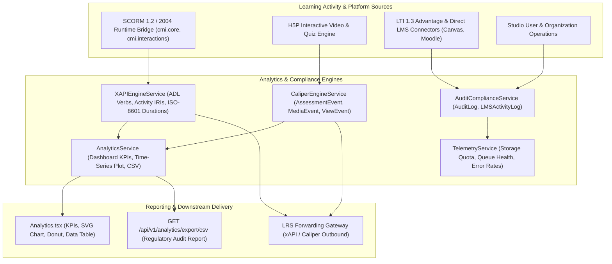

# Phase 06: Analytics, Reporting & Audit Compliance Engine Architecture

## 1. Executive Summary

Phase 06 establishes the **Analytics, Reporting & Audit Compliance Engine** for the **SCORM & H5P Authoring Studio**. The architecture establishes a unified framework for tracking, analyzing, and auditing learning interactions across multiple standards and distributed LMS endpoints. It encompasses ADL xAPI v1.0.3 statement synthesis, IMS Caliper Analytics v1.2 event logging, tamper-evident LMS grade push audits, learner progress aggregation, and real-time enterprise telemetry.

---

## 2. Architectural Pillars

1. **Dual Interoperability Standards**:
   - **ADL xAPI (Tin Can)**: Emits rich statements (`actor`, `verb`, `object`, `result`, `context`) with standard ADL verb IRIs and ISO-8601 duration formatting.
   - **IMS Caliper Analytics v1.2**: Emits semantic learning events (`AssessmentEvent`, `MediaEvent`, `NavigationEvent`, `ViewEvent`) for enterprise ed-tech ecosystems.
2. **Immutable & Tamper-Evident Auditing**:
   - Every LMS synchronization, grade push, package export, or administrative permission mutation writes an immutable row into `AuditLog` or `LMSActivityLog`.
   - Records capture client IP, user agent, old/new value snapshots, and error logs to satisfy SOC2, FERPA, and ISO 27001 audit standards.
3. **Multi-Tenant Data Isolation**:
   - All analytics, KPIs, and audit trails are partitioned strictly by `organizationId`. Cross-tenant queries are blocked at both application and database layers.
4. **Deterministic Progress & Performance Aggregation**:
   - Computes dynamic completion rates, score distributions, and learning hours across SCORM 1.2, SCORM 2004, and H5P packages.
5. **Real-Time Enterprise Telemetry**:
   - Live telemetry monitors storage quota utilization, asynchronous export queue throughput, and LMS grade-push error rates.
