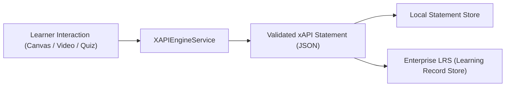

# xAPI Statement Engine & LRS Dispatch Specification

## 1. Overview

The `XAPIEngineService` synthesizes and validates statements conforming to the **ADL xAPI Specification v1.0.3**. xAPI provides human- and machine-readable records of granular learning activities across devices.



---

## 2. Statement Model & Data Structures

```typescript
export interface XAPIStatement {
  id: string;             // UUID v4
  timestamp: string;      // ISO-8601
  actor: XAPIActor;       // Agent with name & mbox (mailto:...)
  verb: XAPIVerb;         // ADL Verb IRI + display map
  object: XAPIObject;     // Activity IRI + definition
  result?: XAPIResult;    // Score, success, completion, ISO-8601 duration
  context?: XAPIContext;  // Parent activity, registration, platform
  version?: string;       // "1.0.3"
}
```

---

## 3. ADL Verb Vocabulary

| Verb | Verb IRI | Semantic Trigger |
| :--- | :--- | :--- |
| `initialized` | `http://adlnet.gov/expapi/verbs/initialized` | Learner launches SCORM / H5P course container. |
| `experienced` | `http://adlnet.gov/expapi/verbs/experienced` | Learner views a slide or watches a video segment. |
| `interacted` | `http://adlnet.gov/expapi/verbs/interacted` | Learner clicks an interactive video hotspot. |
| `attempted` | `http://adlnet.gov/expapi/verbs/attempted` | Learner begins a knowledge check assessment. |
| `answered` | `http://adlnet.gov/expapi/verbs/answered` | Learner selects an option in a multiple-choice question. |
| `passed` | `http://adlnet.gov/expapi/verbs/passed` | Learner completes assessment at or above passing score. |
| `failed` | `http://adlnet.gov/expapi/verbs/failed` | Learner completes assessment below required passing score. |
| `completed` | `http://adlnet.gov/expapi/verbs/completed` | Learner finishes all required course slides. |
| `terminated` | `http://adlnet.gov/expapi/verbs/terminated` | Learner exits or unloads the course window. |

---

## 4. ISO-8601 Duration Formatting

Learning sessions format durations according to ISO-8601:
$$T \to \text{"PT"} + [H\text{"H"}] + [M\text{"M"}] + S\text{"S"}$$
- $754\text{ seconds} \implies \text{"PT12M34S"}$
- $3,665\text{ seconds} \implies \text{"PT1H1M5S"}$
- $0\text{ seconds} \implies \text{"PT0S"}$
