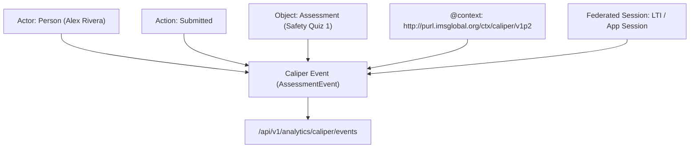

# IMS Caliper Analytics v1.2 Event Engine

## 1. Overview

The `CaliperEngineService` provides full support for the **1EdTech (IMS Global) Caliper Analytics Standard v1.2**. Caliper provides an event-based data model optimized for institutional learning analytics pipelines and data lakes.

---

## 2. Event Types & Action Mapping

| Caliper Event Type | Actions Supported | Typical Learning Trigger |
| :--- | :--- | :--- |
| `AssessmentEvent` | `Started`, `Submitted`, `Paused`, `Restarted` | Graded quiz attempt lifecycle. |
| `AssessmentItemEvent` | `Completed`, `Skipped` | Individual quiz question responses. |
| `MediaEvent` | `Started`, `Paused`, `Resumed`, `JumpedTo`, `Ended` | Interactive video playback interactions. |
| `ViewEvent` | `Viewed` | Slide or document view events. |
| `NavigationEvent` | `NavigatedTo` | Learner transitions between course slides. |

---

## 3. Structural Compliance Requirements

Every valid Caliper Event must provide:
1. `@context`: Exactly `"http://purl.imsglobal.org/ctx/caliper/v1p2"`.
2. `id`: A valid URN or IRI (e.g. `urn:uuid:3f98c11e-7b3a-4a24-912b-2394a118e9a2`).
3. `type`: One of the recognized Caliper event profile names.
4. `actor`: A Caliper `Person` entity with `id` and `type`.
5. `action`: A standard Caliper action string.
6. `object`: A Caliper entity representing the target digital resource.
7. `eventTime`: ISO-8601 UTC timestamp.
8. `edApp`: `SoftwareApplication` entity identifying the authoring studio.
