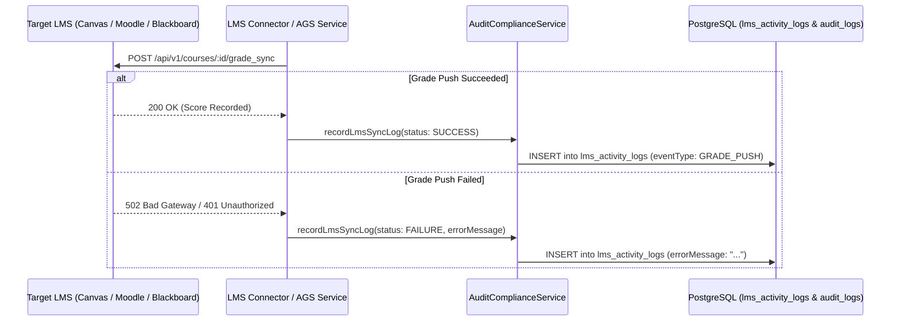

# LMS Grade-Sync & Activity Audit Trail Specification

## 1. Overview

The `AuditComplianceService` records all data transfers, grade push synchronizations, and administrative actions into immutable database tables (`AuditLog` and `LMSActivityLog`) to guarantee regulatory compliance and audit traceability.



---

## 2. LMS Activity Log Schema

```prisma
model LMSActivityLog {
  id              String   @id @default(uuid()) @db.Uuid
  lmsConnectionId String   @map("lms_connection_id") @db.Uuid
  lmsDeploymentId String?  @map("lms_deployment_id") @db.Uuid
  eventType       String   @map("event_type") @db.VarChar(50) // "PUBLISH", "SYNC", "GRADE_PUSH"
  status          String   @db.VarChar(20) // "SUCCESS", "FAILURE"
  payload         Json?    @db.JsonB
  errorMessage    String?  @map("error_message") @db.Text
  createdAt       DateTime @default(now()) @map("created_at")

  lmsConnection LMSConnection  @relation(fields: [lmsConnectionId], references: [id], onDelete: Cascade)
  deployment    LMSDeployment? @relation(fields: [lmsDeploymentId], references: [id], onDelete: SetNull)

  @@index([lmsConnectionId, createdAt])
  @@map("lms_activity_logs")
}
```

---

## 3. General Organization Audit Log Schema

Tracks all critical administrative and content modifications:
- `PROJECT_DELETE`
- `ROLE_ASSIGN`
- `PACKAGE_EXPORT`
- `SETTINGS_UPDATE`
- `INVITATION_REVOKE`

Each record captures:
- `organizationId`: Verified tenant boundary.
- `userId`: Identity of the actor who performed the action.
- `oldValues` & `newValues`: JSON snapshots of the pre- and post-mutation state.
- `ipAddress` & `userAgent`: Network forensic telemetry.
