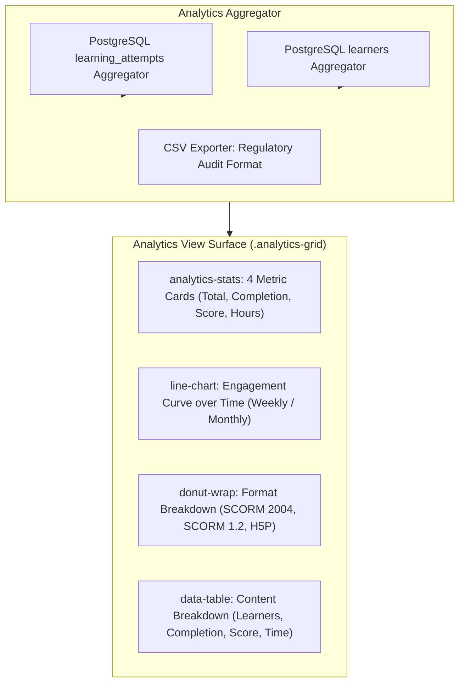

# Learner Progress & Analytics Dashboards Specification

## 1. Overview

The `AnalyticsService` computes aggregated metrics and renders live engagement dashboards via `Analytics.tsx` while strictly preserving Figma Make layout, styling, and visual tokens.

---

## 2. Core KPI Definitions

1. **Total Learners**: Unique learners registered across the organization's published courses.
2. **Average Completion Rate**:
   $$\text{Completion Rate } \% = \left(\frac{N_{\text{completed attempts}}}{N_{\text{total attempts}}}\right) \times 100$$
3. **Average Score**: Mean raw percentage score achieved across all completed assessment sessions.
4. **Learning Hours**: Total accumulated learning duration expressed in hours:
   $$\text{Learning Hours} = \frac{\sum t_{\text{session seconds}}}{3600}$$

---

## 3. CSV Regulatory Audit Export

- **Endpoint**: `GET /api/v1/analytics/export/csv`
- Generates standard CSV reports formatted for accreditation reviews and corporate compliance audits.
- Includes header metadata, KPI summaries, detailed content performance rankings, and package format distributions.
