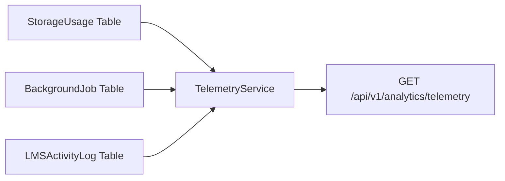

# Enterprise Telemetry & Storage Metrics Specification

## 1. Overview

The `TelemetryService` computes operational health metrics, queue throughput, storage utilization, and connector error rates.



---

## 2. Telemetry Schema & Indicators

```typescript
export interface SystemTelemetryDto {
  storage: {
    totalBytesUsed: string;
    packageBytes: string;
    filesCount: number;
    quotaBytes: string;
    quotaUtilizationPercent: number;
  };
  exportQueue: {
    queuedCount: number;
    processingCount: number;
    completedCount: number;
    failedCount: number;
    successRatePercent: number;
  };
  lmsSync: {
    totalSyncEvents: number;
    successfulSyncs: number;
    failedSyncs: number;
    errorRatePercent: number;
  };
  timestamp: string;
}
```

---

## 3. Quota & Health Calculation Rules

1. **Storage Quota Utilization**:
   $$\text{Quota } \% = \left(\frac{\text{totalBytesUsed}}{\text{quotaBytes}}\right) \times 100$$
2. **Export Queue Success Rate**:
   $$\text{Success } \% = \left(\frac{N_{\text{completed}}}{N_{\text{completed}} + N_{\text{failed}}}\right) \times 100$$
3. **LMS Sync Error Rate**:
   $$\text{Error } \% = \left(\frac{N_{\text{failed syncs}}}{N_{\text{total syncs}}}\right) \times 100$$
