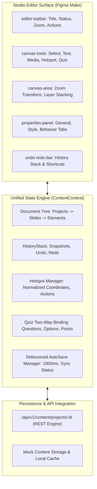

# Phase 04: Authoring Canvas Architecture & Studio Core Engine

## 1. Executive Summary

Phase 04 establishes the Interactive Authoring Canvas & Real-Time Studio Editor Integration for the **SCORM & H5P Authoring Studio**. The architecture unites real-time UI state management, two-way data binding, dynamic property manipulation, interactive hotspot coordinate mapping, undo/redo history stacks, and multi-device preview simulations into an industrial-grade authoring suite while maintaining **100% pixel-perfect fidelity** with the approved Figma Make UI layout and styling system.



---

## 2. Architectural Principles

1. **Strict Figma Make Fidelity**: All structural HTML tags, CSS classes (`.editor-shell`, `.canvas-area`, `.interactive-video`, `.hotspot`, `.properties-panel`, `.field-row`, `.color-swatch`), and visual layouts are preserved without deviation.
2. **Deterministic Unidirectional Data Flow with Two-Way Inspector Binding**: Canvas element properties render strictly from state; user modifications in the properties inspector immediately update the reactive state model and re-render without layout shifts.
3. **Immutable History Snapshots**: Every destructive or creative mutation creates a cloned state snapshot pushed onto the undo history stack, facilitating non-linear undo/redo operations.
4. **Resilient Autosave Debouncing**: User keystrokes and transformations are debounced (1,000ms), transitioning through `saved -> saving -> saved` states with graceful network fallback.
5. **Multi-Device Simulation Consistency**: Desktop (1050x650), tablet (720x760), and mobile (375x720) viewport profiles calculate exact responsive bounds for learner-facing simulations.

---

## 3. Core Component Layout & Roles

| Component | Directory | Functionality |
| :--- | :--- | :--- |
| `AuthoringWorkspace` | `src/features/authoring-workspace/` | Main 3-pane canvas workspace (Slide Nav, Canvas Stage, Properties Inspector). |
| `QuizEditor` | `src/features/quiz-editor/` | Assessment authoring interface with dynamic question and option synchronization. |
| `PreviewScreen` | `src/features/preview/` | Multi-device learner simulator with knowledge check evaluation and score calculation. |
| `ContentContext` | `src/context/ContentContext.tsx` | Global reactive state store managing projects, slides, elements, undo stack, and autosave. |
| `EditorSyncService` | `src/services/editor-sync.service.ts` | Backend REST synchronization with offline fallback for element and project persistence. |

---

## 4. Canvas Coordinate & Scaling System

The canvas stage supports dynamic zoom scaling (`50%`, `80%`, `100%`, `120%`) using CSS GPU-accelerated transforms:
```css
transform: scale(${zoom / 100});
transform-origin: center center;
transition: transform 0.2s cubic-bezier(0.16, 1, 0.3, 1);
```
All child element coordinates and hotspot positions remain internally normalized (`0%` to `100%` relative to the bounding box) to ensure exact positioning irrespective of canvas zoom levels or screen resolutions.
