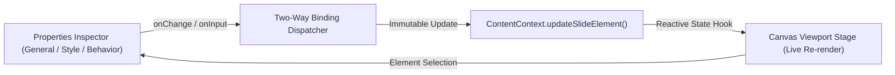

# Element State Management & Properties Inspector Integration

## 1. Overview

The Properties Inspector provides real-time, bidirectional inspection and control over canvas elements and slide properties. Organized into three distinct tabs—**General**, **Style**, and **Behavior**—the inspector updates the active slide or active element directly in `ContentContext`.



---

## 2. Inspector Tab Taxonomy

### A. General Tab
- **Slide Dimensions**: Width (1920px), Height (1080px), Aspect Ratio presets (16:9, 4:3, 1:1, 9:16).
- **Element Geometry**: Position `(X, Y)` in pixels, Bounding Box `(Width, Height)` in pixels.
- **Rotation**: `0°` to `360°` rotation slider.
- **Z-Index Layering**: "Bring to Front", "Send to Back", "Forward", "Backward" controls.

### B. Style Tab
- **Color Swatches**: Palette presets (`#0284c7`, `#10b981`, `#f59e0b`, `#ef4444`, `#8b5cf6`, `#334155`).
- **Typography**: Font family, font size stepper (10px–72px), font weight (Normal, Medium, Bold).
- **Border & Corner Radius**: Border radius stepper (0px–32px), border color, border width.
- **Shadow Effects**: Drop shadow presets (`none`, `soft`, `medium`, `elevated`).
- **Opacity**: Linear opacity slider (`0%` to `100%`).

### C. Behavior Tab
- **Trigger Actions**: None, Jump to Slide, Open External URL, Open Modal Dialog, Launch Assessment.
- **Hotspot Management**: Add Hotspot button, list of attached hotspots with direct edit and delete triggers.
- **Playback Window**: Start time (`00:00`), End time (`00:15`), Autopause on trigger.

---

## 3. Data Structure & Type Signatures

```typescript
export interface SlideElement {
  id: string;
  type: "text" | "image" | "video" | "shape" | "hotspot";
  x: number;
  y: number;
  width: number;
  height: number;
  rotation?: number;
  zIndex?: number;
  opacity?: number;
  borderRadius?: number;
  backgroundColor?: string;
  borderColor?: string;
  borderWidth?: number;
  boxShadow?: string;
  textContent?: string;
  fontSize?: number;
  fontColor?: string;
  hotspots?: Hotspot[];
}
```

---

## 4. Real-Time Mutation Flow

When a user modifies a property in the inspector (e.g. changing opacity to 85%):
1. The synthetic `onChange` event fires on `<input type="range" />`.
2. `updateActiveSlideElement({ opacity: 0.85 })` is dispatched.
3. The previous state is pushed onto the `undoStack`.
4. The canvas immediately updates via React's virtual DOM reconciliation without reloading media elements.
5. `saveStatus` flips to `"saving"` and triggers a debounced background sync.
