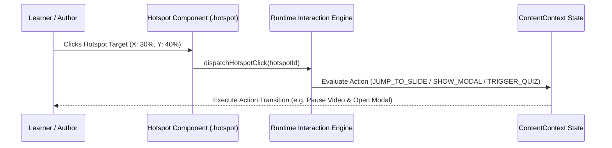

# Hotspot & Interactive Video Engine

## 1. Engine Architecture

The Hotspot Engine turns standard video, image, or slide layers into interactive branchable learning experiences. Hotspots are represented as spatial anchors positioned via percentage-based coordinates relative to their parent element.



---

## 2. Coordinate System & Normalization

To ensure hotspots remain precisely anchored across diverse aspect ratios, device scales, and zoom factors:
- **X Coordinate**: Normalized as `(pixelX / parentWidth) * 100`, bounded strictly between `0.0` and `100.0`.
- **Y Coordinate**: Normalized as `(pixelY / parentHeight) * 100`, bounded strictly between `0.0` and `100.0`.
- **CSS Positioning**:
  ```css
  .hotspot {
    position: absolute;
    top: ${hotspot.y}%;
    left: ${hotspot.x}%;
    transform: translate(-50%, -50%);
    cursor: pointer;
  }
  ```

---

## 3. Interactive Actions Supported

| Action Type | Trigger Condition | Execution Result |
| :--- | :--- | :--- |
| `SHOW_TEXT` | Click or Hover | Displays an instructional tooltip or floating callout bubble. |
| `JUMP_TO_SLIDE` | Click | Navigates the course runtime directly to a target slide ID. |
| `TRIGGER_QUIZ` | Click or Timestamp | Halts media playback and presents an inline Knowledge Check question. |
| `OPEN_URL` | Click | Opens an external documentation URL or resource in a new tab. |
| `PAUSE_PLAY` | Click | Toggles video playback state between playing and paused. |

---

## 4. Time-Window Gating for Interactive Video

For video elements, hotspots can optionally specify a temporal validity window:
- `startTimeSec`: Playback offset when the hotspot becomes visible and clickable.
- `endTimeSec`: Playback offset when the hotspot automatically vanishes.
- **Evaluation Rule**:
  $$\text{Visible} \iff \text{startTimeSec} \le t_{\text{current}} \le \text{endTimeSec}$$
