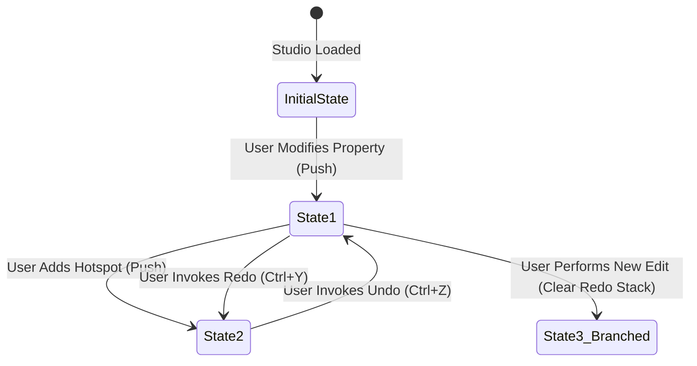

# Undo/Redo History Management Engine

## 1. Memento Architecture

The Authoring Studio implements the **Memento Design Pattern** to guarantee reliable, non-destructive undo and redo operations across canvas element updates, hotspot adjustments, slide deletions, and property mutations.



---

## 2. Invariants & Rules

1. **Immutable Snapshots**: Each state pushed onto the `undoStack` is deep-cloned to isolate it from subsequent live mutations.
2. **Future Redo Stack Purge**: When an undo operation has been executed and the user performs a new mutation, the `redoStack` is immediately purged, branching history forward cleanly.
3. **Bounded Depth Limit**: The history stack maintains a maximum buffer limit (30 snapshots) using FIFO queue eviction (`undoStack.shift()`) to eliminate unbounded memory growth during lengthy editing sessions.
4. **Keyboard Shortcut Integration**:
   - `Ctrl + Z` (Windows/Linux) or `Cmd + Z` (macOS): `undo()`
   - `Ctrl + Y` or `Ctrl + Shift + Z` (Windows/Linux) or `Cmd + Shift + Z` (macOS): `redo()`
   - `Ctrl + S` or `Cmd + S`: `saveCurrentProject()`

---

## 3. Implementation Code Structure

```typescript
const pushHistorySnapshot = (newSlides: Slide[]) => {
  setUndoStack((prev) => {
    const nextStack = [...prev, JSON.parse(JSON.stringify(slides))];
    if (nextStack.length > 30) nextStack.shift();
    return nextStack;
  });
  setRedoStack([]); // Clears future branch
  setSlides(newSlides);
};

const undo = () => {
  if (undoStack.length === 0) return;
  const previous = undoStack[undoStack.length - 1];
  setUndoStack((prev) => prev.slice(0, prev.length - 1));
  setRedoStack((prev) => [JSON.parse(JSON.stringify(slides)), ...prev]);
  setSlides(previous);
};

const redo = () => {
  if (redoStack.length === 0) return;
  const next = redoStack[0];
  setRedoStack((prev) => prev.slice(1));
  setUndoStack((prev) => [...prev, JSON.parse(JSON.stringify(slides))]);
  setSlides(next);
};
```
