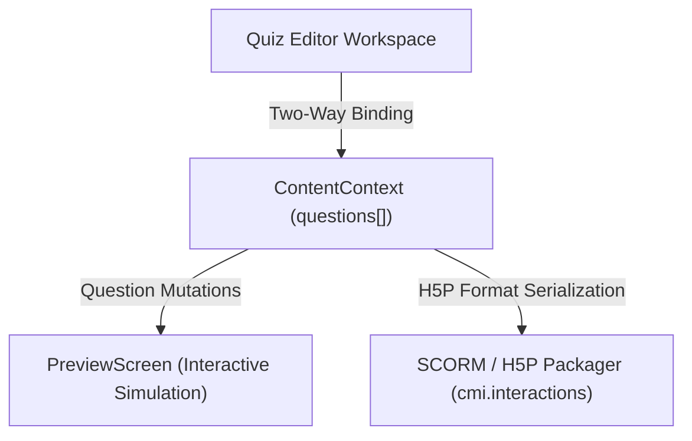

# Quiz Editor & Assessment Integration

## 1. Overview

The Quiz Editor (`src/features/quiz-editor/QuizEditor.tsx`) enables instructional designers to compose interactive assessments, define multiple-choice or true/false interactions, assign point weights, configure retry allowances, and supply immediate feedback.



---

## 2. Assessment Model Schema

```typescript
export interface QuestionOption {
  id: string;
  text: string;
  isCorrect: boolean;
}

export interface Question {
  id: number;
  title: string;
  type: string; // "Multiple choice" | "True/False" | "Multi-select"
  points: number;
  explanation: string;
  correctFeedback: string;
  options: QuestionOption[];
}
```

---

## 3. Operational Features

### A. Dynamic Option Manipulation
- **Add Option**: Appends a new option labeled `Option <N>` with unique identifier `opt-${timestamp}`.
- **Remove Option**: Removes an option, guarding against invalid assessments by enforcing a strict **2-option minimum** threshold.
- **Exclusive Selection**: Clicking an option radio button sets `isCorrect: true` on that option and `isCorrect: false` on all sibling options for multiple-choice items.
- **Inline Editing**: Option labels are editable inline with live synchronization into the data store.

### B. Question Lifecycle Operations
- **Add Question**: Generates a new question with sequential ID, default title, standard points (2), and initialized options.
- **Duplicate Question**: Performs deep cloning of an existing question, regenerating new unique IDs for both the question entity and all child options while appending `(Copy)` to the title.
- **Delete Question**: Removes a question from the assessment, safely refocusing active question state to the first available question and preventing deletion of the final remaining question.
- **Shuffle Options**: Fisher-Yates array permutation to test randomized presentation order.

### C. Feedback & Remediation
- **Correct Feedback**: Shown to the learner upon choosing the correct response.
- **Remediation & Explanation**: Detailed reasoning explaining why the correct choice is safe and appropriate, mapping directly into SCORM/LMS cmi evaluation fields.
