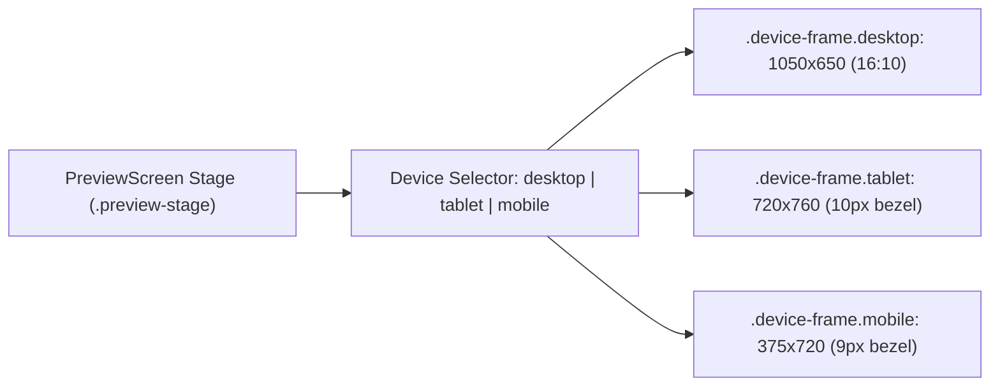

# Device Preview Simulation & Responsive Engine

## 1. Multi-Device Simulation Architecture

The Preview Screen (`src/features/preview/PreviewScreen.tsx`) enables instructional designers to simulate the learner experience across different device profiles without publishing or exporting to an LMS.

---

## 2. Device Specifications & Viewport Mapping

| Device Profile | Dimensions | Border / Bezel | Aspect Ratio | Primary Target |
| :--- | :--- | :--- | :--- | :--- |
| **Desktop** | $1050 \times 650\text{ px}$ | None (Drop shadow) | $16:10$ | Standard LMS Web Portals |
| **Tablet** | $720 \times 760\text{ px}$ | $10\text{ px}$ solid `#1e293b` (18px radius) | Custom Portrait | iPad, Galaxy Tab |
| **Mobile** | $375 \times 720\text{ px}$ | $9\text{ px}$ solid `#1e293b` (24px radius) | $9:16$ Phone Screen | Mobile Learning Apps |

---

## 3. Interactive Learner Simulation State Machine

The preview simulator manages a full 3-stage learner walkthrough:

1. **Stage 0: Knowledge Check (Assessment & Slide Content)**
   - Displays lesson label, active question prompt, and interactive radio choices (`A`, `B`, `C`).
   - "Continue" button is disabled until the learner selects an answer.
2. **Stage 1: Real-Time Evaluation & Feedback**
   - Displays immediate visual confirmation:
     - Green `CheckCircle2` with "That's correct!" when selecting the correct response.
     - Amber/Red `AlertCircle` with "Review Required" when selecting an incorrect response.
   - Displays `correctFeedback` and `explanation` ("Why this matters").
3. **Stage 2: Summary & Key Takeaways**
   - Displays key safety bullet points before completing the module.
4. **Stage 3: Course Completion**
   - Renders `.completion-screen` with `.completion-mark`.
   - Computes dynamic final score percentage:
     $$\text{Score } \% = \left(\frac{\text{Earned Points}}{\text{Total Available Points}}\right) \times 100$$
   - Displays time spent and slides viewed (`slides.length / slides.length`).
   - Provides quick navigation back to the editor or content library.
5. **Restart**: Topbar restart button restores step 0, clears selection, resets score, and restarts simulation cleanly.
