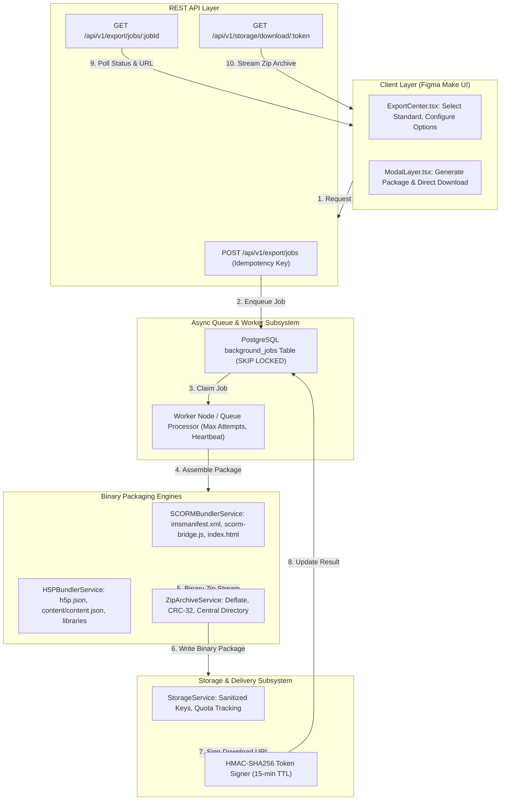

# Phase 05: Cloud Packaging, Storage & Export Automation Engine Architecture

## 1. Executive Summary

Phase 05 establishes the end-to-end **Cloud Packaging, Storage & Export Automation Engine** for the **SCORM & H5P Authoring Studio**. The architecture enables on-demand and asynchronous generation of standard SCORM 1.2, SCORM 2004 (3rd & 4th Editions), and Native H5P (`.h5p`) binary packages. The system couples a zero-dependency PKZIP 2.0 streaming archiver, an asynchronous PostgreSQL `BackgroundJob` queue with distributed worker support, multi-driver storage management with tenant quota isolation, and cryptographically signed, time-limited download gateways.

---

## 2. Core Architectural Principles

1. **Format Compliance**:
   - **SCORM 1.2**: Generates valid `imsmanifest.xml` conforming to IMS Content Packaging v1.1.2 and ADL SCORM 1.2 specifications, complete with `adlcp:masteryscore` and `cmi.core` runtime bridge.
   - **SCORM 2004**: Generates CAM 1.3 / 2004 4th Edition manifests with ADL sequencing definitions and `API_1484_11` runtime bindings.
   - **Native H5P**: Generates compliant `.h5p` zip containers featuring root `h5p.json`, `content/content.json`, and dependency library bundles.
2. **Zero External Archive Dependencies**: The packaging engine relies entirely on standard Node.js `node:zlib` and `node:crypto`, eliminating vulnerable third-party archiver dependencies and ensuring uniform performance across all cloud environments.
3. **Strict Path Sanitization & Defense-in-Depth**: All storage keys are subjected to strict traversal defense, rejecting null bytes, backslashes, relative navigation (`..`), and directory escape sequences.
4. **Idempotent Queue Operations**: Jobs use tenant-scoped composite idempotency keys `(organizationId, jobType, idempotencyKey)`, preventing duplicate compute workloads and duplicate storage allocations.
5. **Cryptographically Signed Download Delivery**: Download links use URL-safe HMAC-SHA256 tokens carrying embedded expiration timestamps and tenant metadata. Tampered, replayed, or expired tokens are rejected at the gateway.

---

## 3. Subsystem Breakdown

| Subsystem | Core Module | Primary Responsibility |
| :--- | :--- | :--- |
| **PKZIP Engine** | `ZipArchiveService` | Assembles local headers, deflated data streams, central directory headers, and EOCD records. |
| **SCORM Bundler** | `SCORMBundlerService` | Synthesizes `imsmanifest.xml`, responsive `index.html`, `scorm-bridge.js`, and `course-data.json`. |
| **H5P Bundler** | `H5PBundlerService` | Synthesizes `h5p.json` manifests, `content/content.json` parameter trees, and dependency descriptors. |
| **Storage Service** | `StorageService` | Enforces path sanitization, writes files, tracks tenant quota, and issues HMAC signed tokens. |
| **Export Queue** | `ExportQueueService` | Orchestrates atomic job claiming, status transitions, worker retries, and error logging. |
| **Download Gateway** | `StorageController` | Authenticates signed tokens, streams zip archives with RFC 6266 `Content-Disposition`. |
