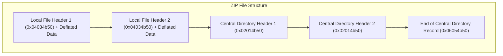

# Binary Packaging Engine: PKZIP 2.0, SCORM & H5P

## 1. Zero-Dependency PKZIP 2.0 Engine

The `ZipArchiveService` builds standard PKZIP 2.0 archive buffers using Node.js `node:zlib` and `node:buffer`.



### Binary Structure Specifications
- **Local File Header (30 bytes + name length)**:
  - Signature: `0x04034b50`
  - Version needed: `20` (v2.0)
  - General purpose flags: `0x0800` (UTF-8 filename encoding)
  - Compression Method: `8` (Deflate) or `0` (Stored)
  - CRC-32 checksum, compressed size, uncompressed size
- **Central Directory Header (46 bytes + name length)**:
  - Signature: `0x02014b50`
  - Relative offset pointing to the exact byte offset of the corresponding local header
- **End of Central Directory (EOCD, 22 bytes)**:
  - Signature: `0x06054b50`
  - Total records count, central directory byte size, and start offset

---

## 2. SCORM Package Composition

A compiled SCORM package (`.zip`) includes:

```
package-name.zip
├── imsmanifest.xml           # ADL SCORM XML manifest with SCO organizations & resources
├── index.html                # Responsive HTML5 course launch container
├── scorm-bridge.js           # Multi-version SCORM runtime bridge adapter
├── course-data.json          # Serialized slides, canvas elements, hotspots, and quiz data
├── imscp_rootv1p1p2.xsd      # IMS content packaging schema definition
└── adlcp_rootv1p1p2.xsd      # ADL content packaging extension schema
```

### Runtime Bridge Architecture (`scorm-bridge.js`)
The bridge script traverses the window hierarchy (`window`, `window.parent`, `window.top`, `window.opener`) looking for the LMS API adapter:
- **SCORM 1.2**: Interacts with `window.API` via `LMSInitialize`, `LMSSetValue("cmi.core.lesson_status", ...)`, `LMSCommit`, and `LMSFinish`.
- **SCORM 2004**: Interacts with `window.API_1484_11` via `Initialize`, `SetValue("cmi.completion_status", ...)`, `SetValue("cmi.score.raw", ...)`, `Commit`, and `Terminate`.

---

## 3. H5P Archive Composition

An exported H5P package (`.h5p`) contains:

```
package-name.h5p
├── h5p.json                               # Top-level package metadata & dependency manifest
├── content/
│   └── content.json                       # Content parameter tree (interactive video, questions)
└── H5P.InteractiveVideo-1.22/
    └── library.json                       # Preloaded dependency library metadata
```
