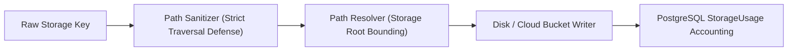

# Cloud Storage Abstraction & Tenant Quota Accounting

## 1. Storage Architecture

The Storage Subsystem (`StorageService`) handles file persistence across cloud disk and object stores while providing directory traversal defense and tenant quota accounting.



---

## 2. Directory Traversal Exploit Mitigation

To eliminate directory traversal vulnerabilities (CWE-22):
1. **Null Byte Elimination**: Keys containing null bytes (`\0`) or ASCII control characters (`[\x00-\x1f]`) are rejected immediately.
2. **Backslash Normalization**: Backslashes (`\`) are normalized to standard forward slashes (`/`).
3. **Relative Escape Denial**: Paths containing `..`, `.`, or empty segments are rejected with `400 Bad Request`.
4. **Boundary Verification**: The final resolved path is checked against `rootDir`:
   ```typescript
   if (!resolved.startsWith(this.rootDir)) {
     throw AppError.badRequest("Path traversal violation");
   }
   ```

---

## 3. Storage Usage & Quota Tracking

Every binary write triggers an update to the tenant's `StorageUsage` record:
```prisma
model StorageUsage {
  id             String   @id @default(uuid()) @db.Uuid
  organizationId String   @map("organization_id") @db.Uuid
  totalBytesUsed BigInt   @map("total_bytes_used")
  videoBytes     BigInt   @default(0) @map("video_bytes")
  imageBytes     BigInt   @default(0) @map("image_bytes")
  audioBytes     BigInt   @default(0) @map("audio_bytes")
  documentBytes  BigInt   @default(0) @map("document_bytes")
  packageBytes   BigInt   @default(0) @map("package_bytes")
  filesCount     Int      @default(0) @map("files_count")
  recordedAt     DateTime @default(now()) @map("recorded_at")
}
```
- **Default Tenant Quota**: 10 GB ($10,737,418,240\text{ bytes}$).
- **Enforcement**: Write operations check available quota headroom prior to writing packages.
