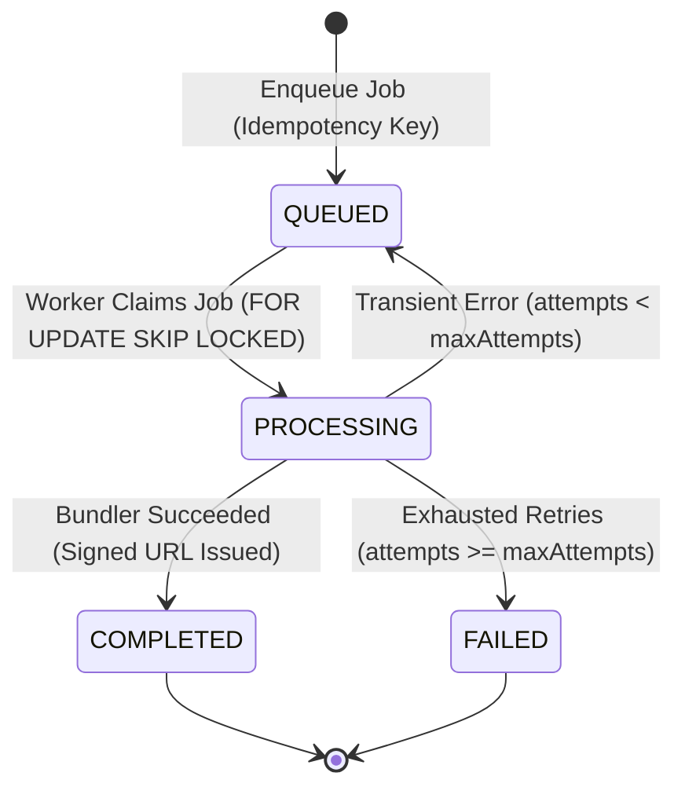

# Asynchronous Export Queue & Distributed Worker Pool

## 1. Queue Architecture

The Export Queue (`ExportQueueService`) offloads heavy zip packaging and media compilation from the main HTTP request loop into background worker processes.



---

## 2. Idempotency Key Strategy

To prevent redundant export workloads when users repeatedly click "Generate package" or network retries fire:
- The queue generates an idempotency key:
  $$\text{Key} = \text{projectId} + \text{"-"} + \text{format} + \text{"-"} + \text{MD5}(\text{payload})[0..10]$$
- Database composite constraint:
  `@@unique([organizationId, jobType, idempotencyKey])`
- If a job with this key is already `QUEUED`, `PROCESSING`, or `COMPLETED`, the existing record is returned immediately.

---

## 3. Worker Concurrency & Lock Leases

1. **Job Claiming**:
   ```sql
   SELECT * FROM background_jobs
   WHERE status = 'QUEUED'
   ORDER BY priority DESC, created_at ASC
   LIMIT 1
   FOR UPDATE SKIP LOCKED;
   ```
2. **Heartbeats & Stale Lock Reclamation**:
   - Running workers periodically update `heartbeat_at = NOW()`.
   - If a worker crashes or becomes unresponsive (heartbeat older than 5 minutes), the lease recovery monitor resets the job to `QUEUED`.
3. **Retry Backoff**:
   - `max_attempts`: default 3.
   - On error, `attempts` is incremented. If `attempts < max_attempts`, status reverts to `QUEUED` with exponential backoff delay.
   - If `attempts >= max_attempts`, status transitions to `FAILED` and `error_log` is captured.
