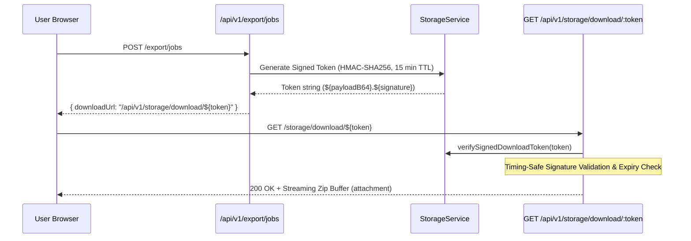

# Signed Download Gateways & Cryptographic Token Security

## 1. Overview

Direct exposure of storage keys or database IDs allows unauthorized resource scraping and cross-tenant data leakage. The Studio employs cryptographically signed, expiring download tokens.



---

## 2. Token Anatomy & HMAC-SHA256 Signing

A signed download token consists of two base64url-encoded parts separated by a dot:
$$\text{Token} = \text{Base64Url}(\text{Payload}) + \text{"."} + \text{Base64Url}(\text{HMAC-SHA256}(\text{PayloadB64}, \text{Secret}))$$

### Payload Structure
```typescript
export interface SignedDownloadTokenPayload {
  storageKey: string;     // Normalized internal path
  organizationId: string; // Tenant boundary identifier
  filename: string;       // Sanitized user-facing download filename
  exp: number;            // Unix epoch expiration timestamp (seconds)
}
```

---

## 3. Security Invariants & Attack Mitigations

1. **Timing-Attack Resistance**:
   Signatures are verified using `crypto.timingSafeEqual()` to prevent side-channel timing attacks:
   ```typescript
   if (sigBuf.length !== expBuf.length || !crypto.timingSafeEqual(sigBuf, expBuf)) {
     throw AppError.unauthorized("Tampered or forged download token signature");
   }
   ```
2. **Replay & Lifetime Bounding**:
   Tokens are valid for a strictly bounded time window (15–30 minutes). Once $\text{epoch}_{\text{now}} > \text{exp}$, the token is rejected with `401 Unauthorized`.
3. **Tenant Bounding**:
   The token encapsulates the `organizationId`. A compromised token from Tenant A cannot be used to read or modify packages belonging to Tenant B.
4. **Header Hardening**:
   - `Content-Type: application/zip` or `application/x-h5p`
   - `Content-Disposition: attachment; filename="${filename}"`
   - `Cache-Control: private, no-transform, no-store`
   - `X-Content-Type-Options: nosniff`
