# 01 - Enterprise Database Architecture & Technical Specification

**Project:** SCORM & H5P Authoring Studio  
**Phase:** 02 — Database Architecture & Schema Design  
**Database Engine:** PostgreSQL 16+  
**ORM / Data Layer:** Prisma ORM 6+ with TypeScript  
**Architecture Pattern:** Multi-Tenant SaaS with Organization Data Isolation  

---

## 1. Architectural Mission & Principles

The database layer serves as the single source of truth for the entire **SCORM & H5P Studio** ecosystem. It is engineered to support:
1. **Multi-Tenant SaaS Isolation:** Robust row-level and organization-boundary tenancy where each customer organization retains full data isolation, dedicated quotas, and customizable roles.
2. **Standard-Compliant Learning Specifications:**
   - **H5P Specification:** Normalized packages, semantic library versioning (`H5P.InteractiveVideo 1.24`), library dependencies (preloaded, dynamic, editor), and parameter trees.
   - **SCORM 1.2 & SCORM 2004 (3rd & 4th Editions):** Explicit data models distinguishing `cmi.core` vs `cmi.completion_status` / `cmi.success_status`, raw vs scaled scores, interaction tracking, and suspend data buffers.
3. **Immutable Content Versioning:** Complete recoverability of published and draft content states. Exports (SCORM/H5P) are tied to immutable snapshots rather than volatile drafts.
4. **Production Scalability & ACID Guarantees:** Relational integrity via foreign keys, cascading deletion where appropriate, restricted deletion for critical dependencies, JSONB for flexible parameter trees, and an index strategy for high-throughput queries.

---

## 2. Technology Stack & Architectural Decision Records (ADR)

### ADR-01: PostgreSQL as Primary Datastore
- **Context:** The application requires strict relational integrity (users, organizations, courses, modules, permissions), JSONB support for H5P parameters and SCORM CMI trees, full-text search, and ACID transactions for financial and compliance data.
- **Decision:** Standardize on PostgreSQL (version 16 or newer).
- **Consequences:** Provides native JSONB operators (`@>`, `jsonb_extract_path`), UUIDv4 primary keys, Partial/Composite indexes, and Row-Level Security (RLS) support.

### ADR-02: Prisma ORM for Data Access & Schema Governance
- **Context:** Frontend is TypeScript-native; backend services will run on Node.js/TypeScript. We need type safety between database tables and API controllers.
- **Decision:** Utilize Prisma ORM with declarative `schema.prisma`.
- **Consequences:** Auto-generated TypeScript types, deterministic migration engine (`prisma migrate`), and compile-time relationship safety.

### ADR-03: Multi-Tenancy Strategy (Shared Database, Isolated Schemas / Row Separation)
- **Context:** Customers require isolated access; some organizations may scale to millions of tracking records.
- **Decision:** Row-Level Tenancy with mandatory `organizationId` foreign keys on all tenant-scoped tables, backed by composite indexes (`[organizationId, id]`) and PostgreSQL Row-Level Security policies.

### ADR-04: Structured Relational vs JSONB Separation
- **Context:** Learning content contains complex hierarchical trees (slides, hotspots, question configurations).
- **Decision:** 
  - *Relational modeling* for all queryable, indexable, foreign-keyed, and audited entities (Users, Courses, Modules, Lessons, ContentProjects, H5PLibraries, MediaAssets, LMSConnections, Attempts, Enrollments).
  - *JSONB modeling* strictly for genuinely flexible or dynamic structures (H5P content parameter trees, SCORM CMI interaction structures, slide visual coordinates, and audit diffs).

---

## 3. High-Level Domain Boundary Architecture

```mermaid
flowchart TD
    subgraph AuthModule["1. Authentication & Tenancy"]
        Org[Organization]
        User[User]
        Member[OrganizationMember]
        Role[Role & Permissions]
        WS[Workspace]
    end

    subgraph ContentModule["2. Courses & Authoring"]
        Course[Course & Modules]
        Project[ContentProject]
        Doc[ContentDocument]
        Version[ContentVersion]
        Element[ContentElement]
        Revision[ContentRevision]
    end

    subgraph H5PModule["3. H5P Core Engine"]
        H5PContent[H5PContent]
        Library[H5PLibrary]
        LibDep[H5PLibraryDependency]
        PkgImport[H5PPackageImport]
        PkgExport[H5PPackageExport]
    end

    subgraph MediaModule["4. Media Management"]
        MediaAsset[MediaAsset]
        MediaFolder[MediaFolder]
        MediaUsage[MediaUsage]
        MediaMeta[MediaMetadata]
    end

    subgraph SCORMModule["5. SCORM Packaging"]
        SCORMPkg[SCORMPackage]
        SCORMJob[SCORMExportJob]
        SCORMMan[SCORMManifest]
        SCORMConf[SCORMRuntimeConfiguration]
        SCORMMapping[SCORMContentMapping]
    end

    subgraph LMSModule["6. LMS Integrations"]
        LMSPlatform[LMSPlatform]
        LMSConn[LMSConnection]
        LMSDeploy[LMSDeployment]
        LMSLog[LMSActivityLog]
    end

    subgraph TrackingModule["7. Learner Tracking & CMI"]
        Learner[Learner]
        Enrollment[Enrollment]
        Attempt[LearningAttempt]
        Session[LearningSession]
        Result[AssessmentResult]
        SCORMRecord[SCORMRuntimeRecord]
    end

    subgraph SystemModule["8. Operations & Auditing"]
        Job[BackgroundJob]
        Audit[AuditLog]
        Notify[Notification]
        Storage[StorageUsage]
    end

    Org --> WS
    Org --> Member
    User --> Member
    WS --> Course
    WS --> Project
    Project --> Doc
    Doc --> Version
    Project --> Element
    Project --> H5PContent
    H5PContent --> Library
    Library --> LibDep
    WS --> MediaAsset
    MediaAsset --> MediaUsage
    Version --> SCORMPkg
    SCORMPkg --> SCORMJob
    SCORMPkg --> SCORMMan
    SCORMPkg --> SCORMConf
    WS --> LMSConn
    LMSConn --> LMSDeploy
    SCORMPkg --> LMSDeploy
    Org --> Learner
    Course --> Enrollment
    Learner --> Enrollment
    Enrollment --> Attempt
    Attempt --> Session
    Attempt --> Result
    Attempt --> SCORMRecord
    Org --> Storage
    Org --> Audit
    Org --> Job
```

---

## 4. Module Specifications Overview

The database is divided into **8 core modules** comprising **42 relational models**:

| Module | Primary Tables | Core Responsibility |
| :--- | :--- | :--- |
| **1. Auth & Tenancy** | `User`, `Organization`, `OrganizationMember`, `Role`, `Permission`, `RolePermission`, `Workspace` | Identity, tenant isolation, role-based access control (RBAC), and workspaces. |
| **2. Courses & Content** | `Course`, `CourseModule`, `Lesson`, `ContentProject`, `ContentDocument`, `ContentVersion`, `ContentElement`, `ContentRevision` | Hierarchical learning paths, authoring documents, slides, and version histories. |
| **3. H5P Engine** | `H5PContent`, `H5PLibrary`, `H5PLibraryDependency`, `H5PContentLibrary`, `H5PPackageImport`, `H5PPackageExport` | Normalized library semantics, dependency trees, package unpacking, and parameters. |
| **4. Media Management** | `MediaAsset`, `MediaFolder`, `MediaUsage`, `MediaMetadata` | Multi-asset storage, duration/dimension metadata, and cross-project asset tracking. |
| **5. SCORM Engine** | `SCORMPackage`, `SCORMExportJob`, `SCORMManifest`, `SCORMRuntimeConfiguration`, `SCORMContentMapping` | SCORM 1.2 / 2004 packaging, imsmanifest.xml, launch configurations, and SCO mapping. |
| **6. LMS Integrations** | `LMSPlatform`, `LMSConnection`, `LMSDeployment`, `LMSActivityLog` | External LMS connection configurations (Moodle, Canvas, Blackboard), sync status, and audit logs. |
| **7. Learner Tracking** | `Learner`, `Enrollment`, `LearningAttempt`, `LearningSession`, `AssessmentResult`, `LearnerProgress`, `SCORMRuntimeRecord` | High-fidelity CMI tracking, raw/scaled scores, time spent, suspend data, and question evaluation. |
| **8. System Operations** | `BackgroundJob`, `AuditLog`, `Notification`, `StorageUsage` | Asynchronous queue jobs, compliance auditing, user notifications, and storage billing metrics. |
