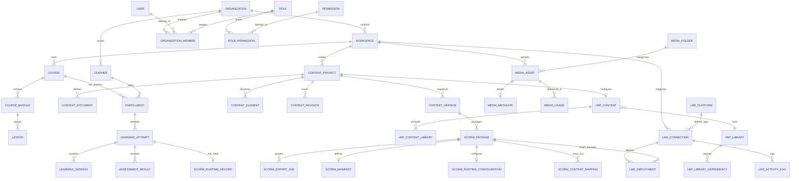
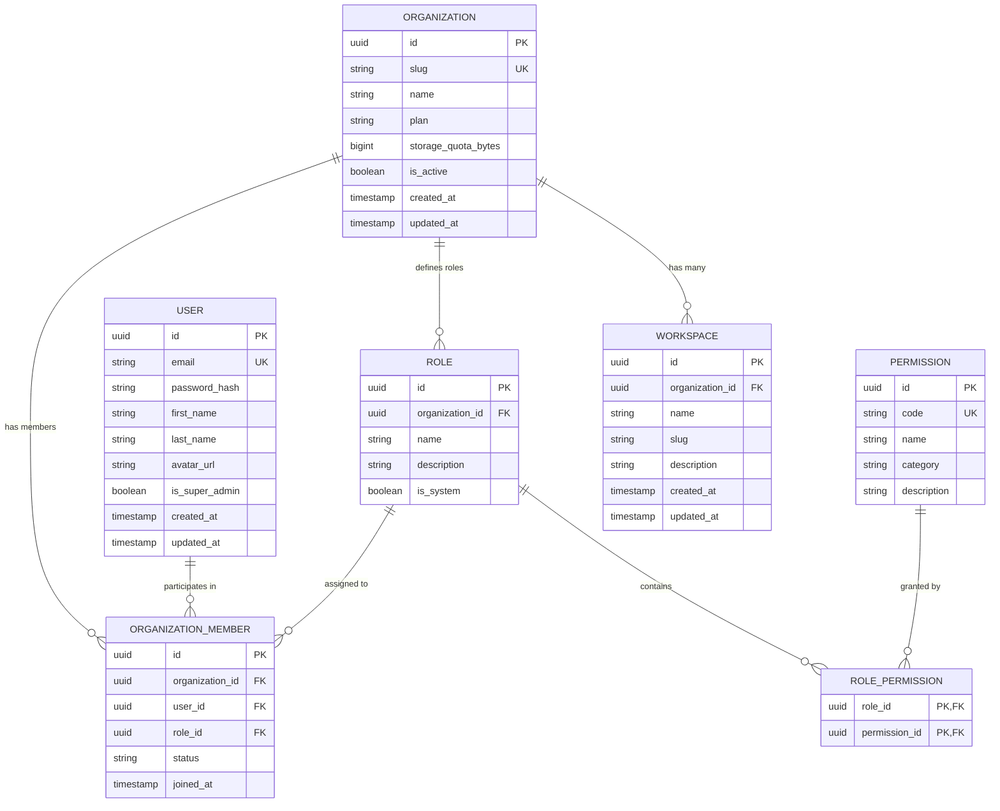
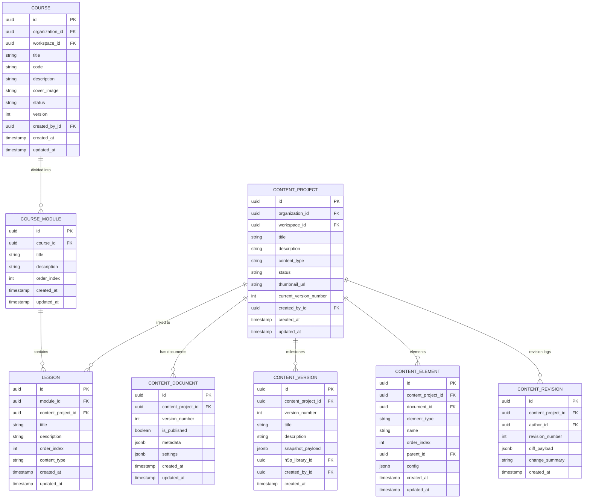
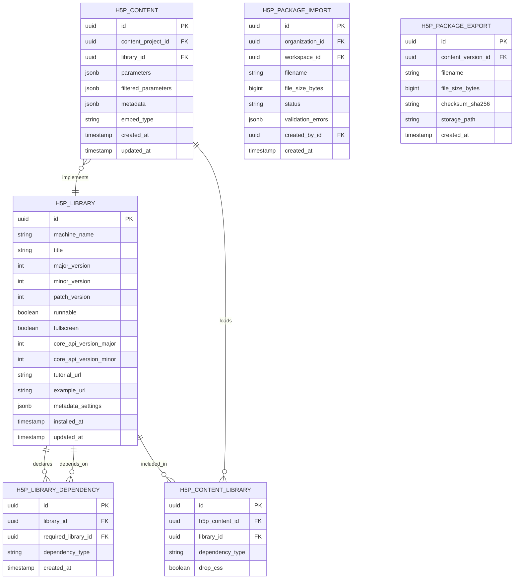
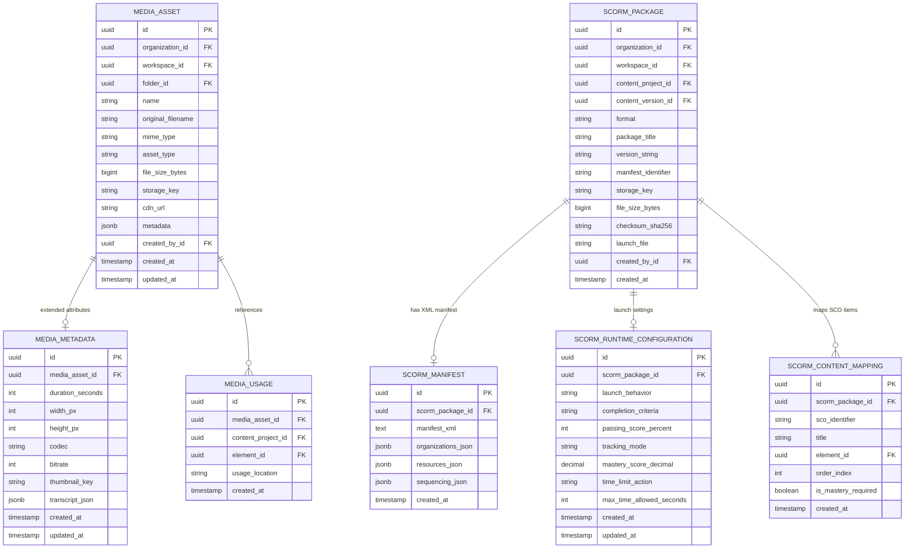
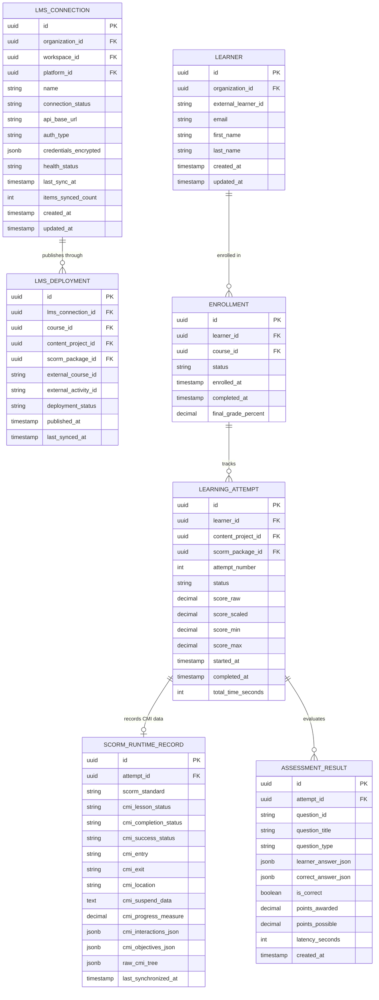

# 02 - Entity Relationship Diagram & Data Models

**Project:** SCORM & H5P Authoring Studio  
**Phase:** 02 — Database Architecture & Schema Design  
**Diagram Format:** Mermaid ER Diagram (`erDiagram`)  

---

## 1. Core Domain Entity Relationship Diagram

---

## 2. Detailed Module Relationship Specifications

### 2.1 Module 1: Authentication & Multi-Tenancy

---

### 2.2 Module 2: Courses & Content Authoring

---

### 2.3 Module 3: H5P Engine & Library Tree

---

### 2.4 Module 4 & 5: Media & SCORM Packaging

---

### 2.5 Module 6 & 7: LMS Integrations & Learner Tracking

