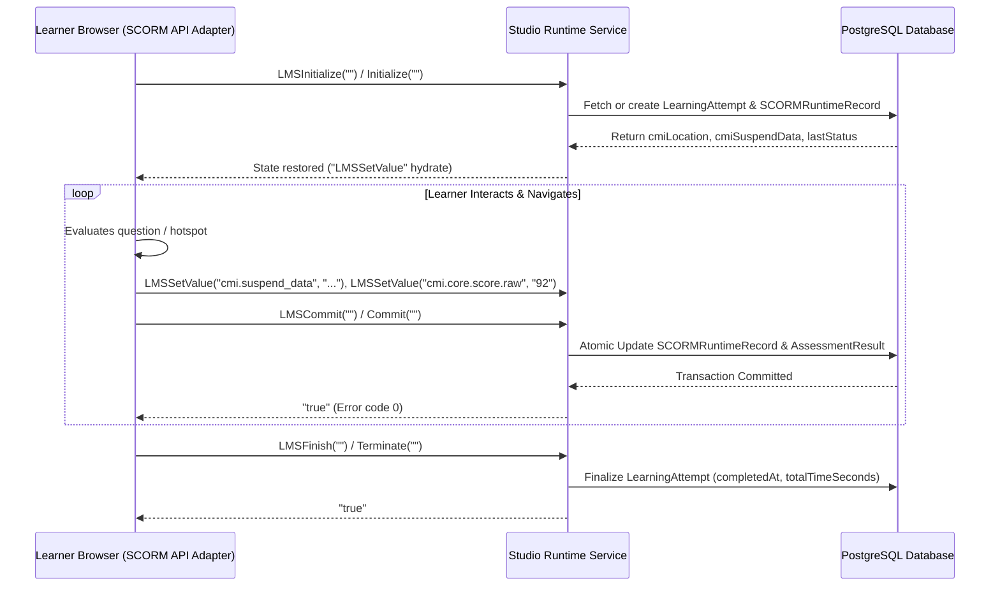

# 07 - SCORM 1.2 vs 2004 Tracking & Runtime CMI Architecture

**Project:** SCORM & H5P Authoring Studio  
**Phase:** 02 — Database Architecture & Schema Design  
**Standards Covered:** SCORM 1.2, SCORM 2004 3rd Edition, SCORM 2004 4th Edition  

---

## 1. Architectural Challenge: The SCORM Paradigm Shift

A primary reason generic LMS platforms fail or corrupt learner progress is that they treat **SCORM 1.2** and **SCORM 2004** as interchangeable. They are fundamentally different specifications with distinct data models, status vocabularies, score representations, and buffer limits.

The database model (`SCORMRuntimeRecord` alongside `LearningAttempt` and `AssessmentResult`) explicitly preserves and normalizes these differences.

---

## 2. Direct Comparison & Field-Level Relational Mapping

| CMI Data Element | SCORM 1.2 Specification | SCORM 2004 Specification | Relational Column in `SCORMRuntimeRecord` |
| :--- | :--- | :--- | :--- |
| **Lesson Status / Completion** | `cmi.core.lesson_status`<br>Values: `passed`, `completed`, `failed`, `incomplete`, `browsed`, `not attempted` | Decoupled into:<br>1. `cmi.completion_status`: `completed`, `incomplete`, `not attempted`, `unknown`<br>2. `cmi.success_status`: `passed`, `failed`, `unknown` | `cmiLessonStatus` (1.2)<br>`cmiCompletionStatus` (2004)<br>`cmiSuccessStatus` (2004) |
| **Normalized Score** | Not supported (raw score only) | `cmi.score.scaled`<br>Normalized decimal: `-1.000` to `1.000` | `scoreScaled Decimal(4, 3)` in `LearningAttempt` |
| **Raw Score Range** | `cmi.core.score.raw`<br>`cmi.core.score.min`<br>`cmi.core.score.max` | `cmi.score.raw`<br>`cmi.score.min`<br>`cmi.score.max` | `scoreRaw Decimal(5, 2)`<br>`scoreMin Decimal(5, 2)`<br>`scoreMax Decimal(5, 2)` |
| **Progress Measure** | Not natively supported | `cmi.progress_measure`<br>Decimal: `0.000` to `1.000` | `cmiProgressMeasure Decimal(4, 3)` |
| **Suspend Data Buffer** | Limited strictly to **4,096 characters** | Expanded to **64,000 characters** in 3rd/4th Editions | `cmiSuspendData Text` |
| **Location / Bookmark** | `cmi.core.lesson_location`<br>Up to 255 chars | `cmi.location`<br>Up to 1,000 chars | `cmiLocation VarChar(255)` |
| **Session Time Format** | `cmi.core.session_time`<br>Format: `HH:MM:SS.SS` | `cmi.session_time`<br>ISO 8601 Duration (e.g. `PT0H11M42S`) | Stored normalized in `sessionTimeSeconds Int` in `LearningSession` |
| **Entry / Exit Mode** | `cmi.core.entry`: `ab-initio`, `resume`, `""`<br>`cmi.core.exit`: `time-out`, `suspend`, `logout`, `""` | `cmi.entry`: `ab-initio`, `resume`, `""`<br>`cmi.exit`: `time-out`, `suspend`, `logout`, `normal`, `""` | `cmiEntry VarChar(20)`<br>`cmiExit VarChar(20)` |

---

## 3. Interaction & Objective Tracking (`cmi_interactions_json`)

Every question answered during a SCORM session (e.g., Multiple Choice, True/False, Drag & Drop) is parsed and stored in two synchronized locations:
1. **Relational Table (`assessment_results`):** Normalized for rapid SQL reporting, completion percentages, average scores, and item-discrimination metrics.
2. **Runtime CMI Tree (`cmi_interactions_json` in `scorm_runtime_records`):** Maintains the full CMI interaction sequence required by LMS engines on resume.

### Interaction JSON Structure:
```json
[
  {
    "id": "urn:northstar:question:safety-spill-01",
    "type": "choice",
    "timestamp": "2026-11-20T14:24:18Z",
    "weighting": 1.0,
    "learner_response": "opt-1",
    "result": "correct",
    "latency": "PT0H0M14S",
    "description": "Which action should you take first when you notice a spill?"
  }
]
```

---

## 4. Runtime Synchronization Workflow (LMS API Wrapper)



---

## 5. Handling SCORM Quirks & Edge Cases

1. **Premature Window Close (Dropoff):** If the learner closes their browser without calling `LMSFinish`, `sessionEndTime` remains null. Periodic heartbeat commits ensure `cmiSuspendData` and `cmiLocation` are saved incrementally every 30 seconds.
2. **Review Mode vs Normal Mode:** When an attempt has `status = 'COMPLETED'` or `'PASSED'`, subsequent launches set `cmi_entry = 'resume'` or `cmi_mode = 'review'` so scores cannot be overwritten by post-test browsing.
3. **Time Calculation Precision:** The runtime converts all proprietary time formats (SCORM 1.2 `HH:MM:SS` vs SCORM 2004 ISO 8601 duration) into integer seconds (`totalTimeSeconds`) for unambiguous aggregation and cross-platform analytics.
