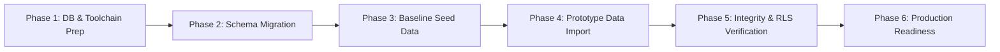

# 09 - Database Migration, Seeding & Rollout Plan

**Project:** SCORM & H5P Authoring Studio  
**Phase:** 02 — Database Architecture & Schema Design  
**Migration Tool:** Prisma Migrate & PostgreSQL DDL  

---

## 1. Migration Execution Roadmap

The database rollout follows a staged 6-phase migration plan.



---

## 2. Step-by-Step Rollout Specifications

### Phase 1: Environment & Toolchain Preparation
- Provision PostgreSQL 16 instance with UTF-8 encoding.
- Configure connection pooling (e.g. PgBouncer or AWS RDS Proxy) to support concurrent learner CMI commits.
- Add `DATABASE_URL` and `DIRECT_URL` environment variables in backend `.env`.

### Phase 2: Schema Initialization (`prisma migrate dev`)
Execute the initial schema generation:
```bash
# Generate the initial SQL migration file
npx prisma migrate dev --name init_enterprise_schema
```
This generates the baseline DDL creating all 42 tables, indexes, enums, and foreign key constraints.

### Phase 3: Seeding Baseline Catalog Data (`prisma/seed.ts`)
Seed invariant reference data required for system operation:
1. **Permissions:** 24 granular permission tokens (`org:manage`, `course:create`, `content:author`, `scorm:export`, `media:upload`, etc.).
2. **System Roles:** `ADMIN`, `CONTENT_CREATOR`, `REVIEWER`, `VIEWER` with pre-assigned permissions.
3. **LMS Platform Catalog:**
   - Moodle Cloud (`MOODLE`, REST / LTI 1.3)
   - Canvas LMS (`CANVAS`, Native API / LTI 1.3)
   - Blackboard Learn (`BLACKBOARD`, LTI 1.3)
   - Docebo (`DOCEBO`, SCORM Cloud / LTI)
   - Brightspace by D2L (`BRIGHTSPACE`, LTI 1.3)
   - Custom LMS (`CUSTOM`, REST webhook)
4. **Core H5P Libraries:**
   - `H5P.InteractiveVideo 1.24.2`
   - `H5P.CoursePresentation 1.22.4`
   - `H5P.InteractiveBook 1.7.0`
   - `H5P.QuestionSet 1.20.1`
   - `H5P.MultiChoice 1.16.2`
   - `H5P.DragQuestion 1.14.3`
   - `H5P.Blanks 1.14.0`
   - `H5P.TrueFalse 1.8.0`
   - `H5P.Flashcards 1.5.0`
   - `H5P.ImageHotspots 1.10.3`
   - Support dependencies: `H5P.JoubelUI 1.3`, `H5P.FontAwesome 4.5`, `H5P.Video 1.6`.

### Phase 4: Prototype Mock Data Ingestion
Transform existing frontend mock records into initial seed records for testing:
- **Default Organization:** Acme Learning (`slug: "acme-learning"`, Business Plan, 100 GB Quota).
- **Default Workspace:** Primary Workspace (`slug: "primary"`).
- **Default Admin User:** Alex Kim (`alex@acme.edu`, Admin role).
- **Initial Projects:** Workplace Safety Essentials, Data Privacy Fundamentals, Customer Success Playbook, etc.
- **Initial Media Assets:** 8 seeded assets (Team workshop, Safety briefing, etc.).

### Phase 5: Integrity & RLS Policy Verification
Run verification scripts:
- Validate that all foreign keys have matching target rows.
- Verify cascading deletes: deleting a test `Course` removes all child `CourseModule` and `Lesson` rows.
- Test `onDelete: Restrict`: attempting to delete a `ContentVersion` with active `SCORMPackage` throws an explicit constraint error.
- Verify Row-Level Security isolation across test tenant tokens.

### Phase 6: Production Safeguards & Rollback Strategy
1. **Zero-Downtime Schema Evolution:** Future schema modifications must follow the expand-and-contract pattern:
   - Step 1: Add new nullable columns or tables.
   - Step 2: Deploy updated application code writing to both old and new columns.
   - Step 3: Backfill historical data via background scripts.
   - Step 4: Drop old columns in a subsequent release.
2. **Automated Rollback Scripts:** Every migration is coupled with a reversible `.down.sql` script.
3. **Backup Guarantee:** Automated snapshot before any production DDL execution.
