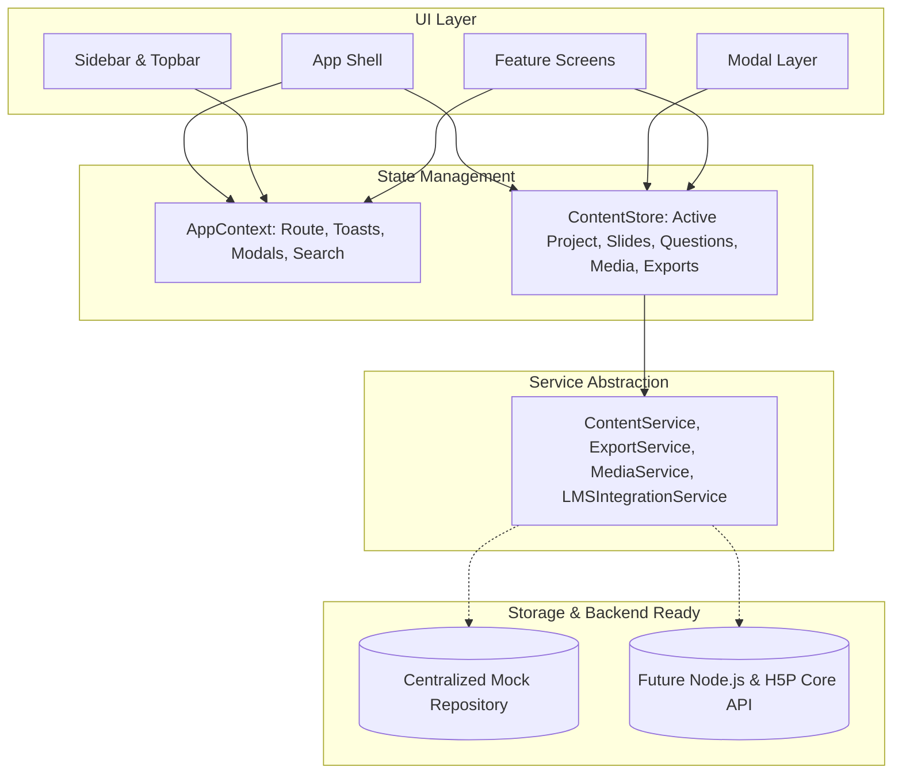

# 02 - Frontend Architecture Specification

**Project:** SCORM & H5P Authoring Studio  
**Document Version:** 1.0.0  
**Status:** Approved Architecture  

---

## 1. Architectural Philosophy & Principles

The architectural objective is to transition the single-file Figma Make prototype into a maintainable, high-performance, modular React 19 + TypeScript application.

### Core Principles
1. **Design Preservation First:** All class names, CSS selectors, layout shells, and DOM hierarchies defined in the original Figma Make output are strictly retained.
2. **Feature-Driven Modularity:** Features own their presentation components, local sub-views, and feature-specific logic, while shared primitives reside in `components/ui/` and `components/navigation/`.
3. **Decoupled Data Architecture:** UI components interact exclusively with typed service interfaces and reactive store contexts rather than hardcoded inline mock arrays.
4. **Predictable State Synchronization:** The Authoring Workspace, Quiz Editor, and Learner Preview share a synchronized Content Document state so edits in the authoring canvas or quiz editor immediately reflect in the preview simulation.
5. **API & Engine Readiness:** Strict adherence to data contracts conforming to H5P specifications (content.json, h5p.json) and SCORM data models (cmi.core, cmi.interactions) to ensure backend drop-in capability.

---

## 2. Target Directory Structure

```
src/
├── types/                          # Pure TypeScript interfaces & data contracts
│   ├── content.types.ts            # H5P content & projects
│   ├── course.types.ts             # Course structures & learning paths
│   ├── editor.types.ts             # 3-panel workspace, slides & elements
│   ├── quiz.types.ts               # Questions, options, scoring & feedback
│   ├── scorm.types.ts              # SCORM 1.2/2004 configs & packages
│   ├── media.types.ts              # Media assets & storage
│   ├── integration.types.ts        # LMS connectors & sync logs
│   ├── analytics.types.ts          # Metrics & learner engagement
│   └── user.types.ts               # Workspace members, profiles & settings
│
├── mocks/                          # Centralized demonstration data
│   ├── content.mock.ts
│   ├── dashboard.mock.ts
│   ├── media.mock.ts
│   ├── integration.mock.ts
│   ├── analytics.mock.ts
│   └── team.mock.ts
│
├── services/                       # Async API client abstractions
│   ├── api-client.ts               # Base HTTP client abstraction
│   ├── content.service.ts          # Content CRUD & H5P package simulation
│   ├── course.service.ts           # Course management
│   ├── media.service.ts            # Media storage & upload simulation
│   ├── export.service.ts           # SCORM & H5P export builder
│   ├── integration.service.ts      # LMS connector services
│   └── analytics.service.ts        # Metric telemetry services
│
├── context/                        # Global & domain state management
│   ├── AppContext.tsx              # Active route, navigation, modals, toasts
│   └── ContentStore.tsx            # Unified document state (Workspace + Quiz + Preview)
│
├── components/
│   ├── ui/                         # Atomic & reusable design primitives
│   │   ├── PageHeader.tsx          # Screen titles & primary action triggers
│   │   ├── PanelTitle.tsx          # Section titles with action buttons
│   │   ├── StatusBadge.tsx         # Unified status pill
│   │   ├── ProjectThumb.tsx        # Styled course thumbnail art
│   │   ├── ToggleRow.tsx           # Switch control
│   │   ├── PropertySection.tsx     # Sidebar property accordion
│   │   ├── EmptyState.tsx          # Empty search/filter placeholders
│   │   └── Toast.tsx               # Notification banner
│   ├── navigation/                 # Navigation system
│   │   ├── Sidebar.tsx             # Collapsible primary sidebar
│   │   └── Topbar.tsx              # Global header with search & profile
│   └── modals/                     # Modal overlay system
│       ├── ModalLayer.tsx          # Modal host & backdrop
│       ├── ImportH5PModal.tsx      # H5P package upload
│       ├── ExportPackageModal.tsx  # SCORM/H5P export modal
│       └── DeleteConfirmModal.tsx  # Destructive action confirmation
│
├── features/                       # Top-level application modules
│   ├── dashboard/                  # Dashboard metrics, recent projects, quick create
│   ├── content-library/            # Library grid/list, filters, item actions
│   ├── content-creation/           # 10 H5P content types gallery
│   ├── courses/                    # Course curriculum & learner enrollment
│   ├── authoring-workspace/        # 3-Panel H5P/SCORM authoring studio
│   ├── quiz-editor/                # Assessment editor & question creator
│   ├── preview/                    # Learner device simulator (Desktop/Tablet/Mobile)
│   ├── export-center/              # SCORM 1.2/2004/H5P package configuration
│   ├── media-library/              # Asset storage, tabs & drag-drop uploader
│   ├── lms-integrations/           # Moodle, Canvas, Blackboard connectors
│   ├── analytics/                  # Charts, completion donuts, performance table
│   ├── team/                       # Member directory & invitations
│   ├── settings/                   # Profile, storage & workspace preferences
│   └── help/                       # Knowledge base & support
│
├── index.css                       # Preserved Figma Make styles (4,252 lines)
├── App.tsx                         # Clean application root & router
└── main.tsx                        # DOM mount
```

---

## 3. Communication & Data Flow



---

## 4. Key Architectural Patterns

1. **Synchronized Authoring State:** The `ContentStore` holds the single source of truth for the currently active learning module (`Workplace Safety Essentials`). When a user edits question answers or toggles video playback behaviors in `QuizEditor` or `AuthoringWorkspace`, the `PreviewScreen` dynamically consumes and evaluates those exact properties.
2. **Predictable Mock Repositories:** All mock data is moved from inline component bodies into immutable structures with initial states copied to reactive stores, enabling creation, duplication, and deletion during a session without fake persistent storage claims.
3. **Graceful Fallbacks:** Empty search states and non-destructive warnings ensure clear user feedback across all views.
