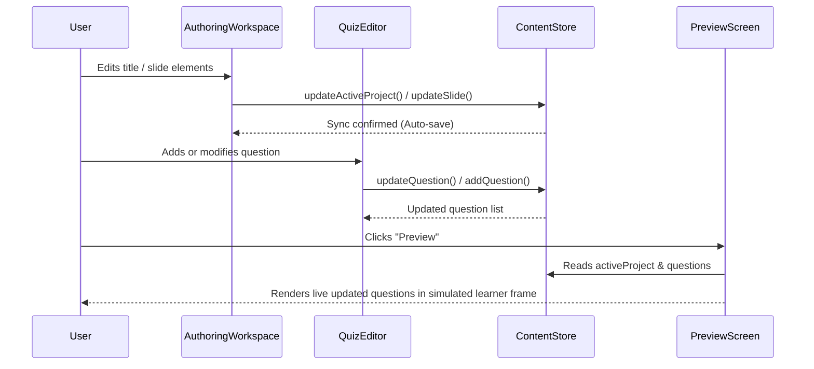

# 05 - State Management Architecture

**Project:** SCORM & H5P Authoring Studio  
**Target:** Unified Reactive State for Authoring, Quiz, and Preview  

---

## 1. Architectural Strategy

To overcome the isolation identified in the codebase audit, the application implements a two-tier state system:

1. **Application Shell State (`AppContext`):**
   - Active Route (`dashboard`, `library`, `courses`, `create`, `editor`, `quiz`, `preview`, `export`, `media`, `integrations`, `analytics`, `team`, `settings`, `help`).
   - Sidebar expansion state (`sidebarOpen`).
   - Mobile navigation drawer toggle (`mobileNav`).
   - Active modal dialog state (`modal`: `null | "import" | "export" | "delete" | "create-course"`).
   - Global search input query (`search`).
   - Toast notification queue & auto-dismissal (`toast`).

2. **Document & Authoring State (`ContentStore`):**
   - Content Project List (`projects`): Supports live filtering, search, project duplication, and deletion.
   - Active Content Project (`activeProject`): The document currently loaded in the 3-panel workspace or preview.
   - Outline Slides (`slides`): Chapters and slides with reordering, addition, and selection.
   - Active Slide ID (`activeSlideId`).
   - Quiz Questions (`questions`): Question set associated with the active project.
   - Active Question ID (`activeQuestionId`).
   - Export Configurations (`exportConfig`).
   - Media Assets (`mediaItems`): Supports upload simulation and filtering.
   - LMS Integrations (`integrations`): Connection states and sync events.

---

## 2. Shared State Synchronization Workflow

---

## 3. Immutability & Persistence Strategy

- **In-Memory React Context with Reducers/Hooks:** Enables instant reactivity across components without heavy third-party state libraries.
- **Session Simulation:** When a user creates a project, duplicates a card, deletes content, or triggers an export, state updates immutably in memory and provides immediate toast feedback.
- **Backend Ready:** Every store action maps directly to future REST endpoints:
  - `addProject()` -> `POST /api/v1/projects`
  - `updateProject()` -> `PUT /api/v1/projects/:id`
  - `deleteProject()` -> `DELETE /api/v1/projects/:id`
  - `exportPackage()` -> `POST /api/v1/export/jobs`
